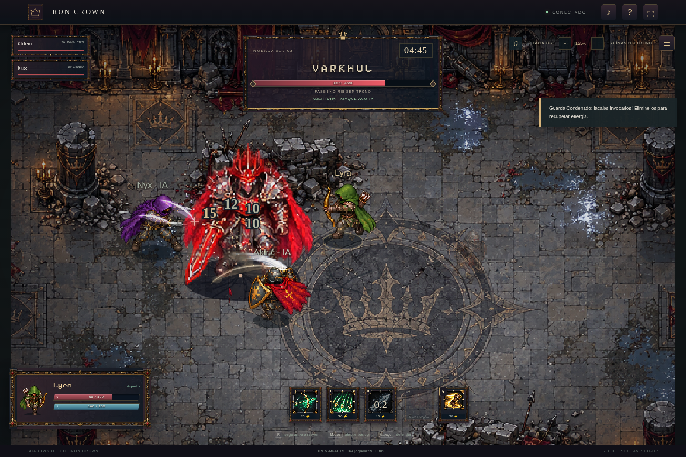

# Shadows of the Iron Crown

Jogo 2D cooperativo para PC Windows, para 1 a 4 jogadores, com servidor local incluído, três classes e três arenas. Jogue solo com companheiros ou com amigos na mesma rede, sem hospedagem paga. Há também um cliente web opcional para desenvolvimento.

## Baixar o jogo pelo GitHub

**[Baixar a versão Windows portátil](https://github.com/joaoviesilva0811-star/ExpotinGAME/releases/download/v1.3.0/IronCrown-Windows-x64.zip)** · **[Página da release](https://github.com/joaoviesilva0811-star/ExpotinGAME/releases/tag/v1.3.0)**

Extraia o ZIP completo e abra **Shadows of the Iron Crown.exe**. Não precisa instalar Node.js. A release é publicada pela automação do GitHub após a tag; o andamento aparece na aba **Actions**.

**Alternativa caso a release ainda esteja sendo preparada:** clique **Code → Download ZIP**, extraia o repositório inteiro e dê dois cliques em **JOGAR-WINDOWS.cmd**. Ele reúne as partes de `windows-package/`, confere o SHA-256, extrai o jogo e abre o executável. Mantenha os arquivos juntos. Nas próximas vezes, basta abrir o mesmo inicializador. A primeira extração pode levar alguns minutos.

O pacote pronto excede o limite de 100 MB por arquivo do GitHub. Por isso, o repositório guarda partes de até 32 MiB; o ZIP íntegro é anexado à release. Desenvolvedores também podem reconstruí-lo com `python3 scripts/restore-windows.py`.

[Assistir à prévia do aplicativo](preview/previa-pc.mp4) · [Passagem pela masmorra](preview/corredor-2.png) · [Cutscene final](preview/pc-10-final.png)



## Jogar no PC sem pagar hospedagem

A edição PC portátil está em `dist/IronCrown-Windows-x64.zip`, para **Windows 10/11 de 64 bits**. Extraia tudo e abra **Shadows of the Iron Crown.exe**. Não é necessário instalar Node.js, ter uma hospedagem ou manter acesso à Internet.

- **Solo com companheiros:** escolha uma classe; os dois bots usam as classes restantes. Se você é cavaleiro, recebe arqueiro e ladino. Os bots são identificados como IA, lutam com recursos normais, tentam esquivar, usam poções e podem reviver aliados. Podem cair, morrer e perder a rodada.
- **Hospedar na rede local:** um PC inicia o servidor automaticamente. Ele mostra IPv4 e código da sala. Precisa permanecer aberto durante a partida.
- **Entrar no PC de um amigo:** abra o executável no outro PC, informe o IPv4 do anfitrião e o código. Sem código, a lista mostra salas públicas daquele PC. Até quatro personagens; bots opcionais no lobby LAN.

Leia [o guia de PC/LAN](docs/PC-LEIA-ME.txt). A conexão local usa TCP 48230 na rede privada; não é preciso abrir portas do roteador. O solo só escuta em loopback. Contas e resultados são locais ao anfitrião; a versão LAN usa sessão rápida e HTTP na rede de confiança.

O pacote usa Electron 44.9.0 e Node 24.19.0 incluídos, com downloads oficiais verificados por SHA-256. A execução da aplicação empacotada foi validada no Linux; a execução do `.exe` em um Windows físico ainda precisa ser confirmada. Não há assinatura digital própria nem instalador. O código de empacotamento está em `scripts/desktop-build.js`.

Para desenvolvedores reconstruírem o pacote (Node 24+, npm e Python 3):

```sh
ELECTRON_SKIP_BINARY_DOWNLOAD=1 npm ci
npm run build:windows
```

O script baixa e verifica os runtimes antes de montar o ZIP. `npm run build:linux` cria a versão Linux equivalente para testes. `node scripts/desktop-smoke.js` testa o aplicativo Linux já empacotado, o runtime incluso, bots, troca de classe, duas instâncias conectadas por TCP, mesmo chefe e reconexão. As capturas são salvas em `artifacts/pc-*.png`. `node scripts/record-preview.js` grava a prévia por screencast do aplicativo em `artifacts/previa-pc.mp4`, com FFmpeg disponível.

## Jogar localmente

Requisito: **Node.js 24 ou superior**, com npm. Não é necessário PostgreSQL, Redis ou compilador. Para o modo de desenvolvimento via navegador, o cliente usa Canvas 2D e módulos JavaScript nativos, sem CDN. O servidor usa WebSocket (`ws`) e SQLite nativo do Node.

```sh
npm ci
npm start
```

Abra `http://localhost:3000`. Crie uma sessão com nome, crie uma sala e compartilhe o código. Cada pessoa escolhe uma classe e marca **Estou pronto**. O líder inicia a expedição. Para testar duas pessoas no mesmo computador, use uma janela anônima ou outro perfil do navegador: duas abas do mesmo perfil usam a mesma sessão e substituem a conexão anterior.

Para jogar pela rede local, acesse `http://IP-DO-SERVIDOR:3000` em cada dispositivo e permita a porta 3000 no firewall. HTTP é permitido apenas no desenvolvimento; use HTTPS/WSS na publicação.

## Controles

| Controle | Ação |
| --- | --- |
| WASD ou setas | Movimentação |
| Mouse | Mirar |
| Botão esquerdo segurado ou J | Ataque básico |
| 1, 2, 3 | Habilidades da classe |
| Espaço segurado | Defesa: −60% de dano, 15 energia/s |
| R segurado | Reviver aliado próximo por 4s, parado e sem sofrer dano |
| E | Dash: 20 de energia, 2,4s de recarga |
| 4 | Usar a próxima poção coletada |
| Tab | Emotes: passinho, braços cruzados, giro, celebração |
| Roda do mouse ou + / − | Aproximar/afastar câmera (inicia em 155%) |
| Esc | Menu local; **não pausa a partida online** |

No celular: joystick, ataque, escudo, reviver e habilidades na tela; mira automática no chefe e câmera que acompanha o jogador no modo retrato. Celular é um suporte inicial; PC oferece mais área visível.

## Atualização 1.3 — Ferro e Cinzas

- Menus, seleção de classe, HUD e diálogos com molduras ilustradas de ferro, madeira e bronze; botões com relevo e retratos de quem fala.
- Falas aparecem gradualmente, com identificação do personagem e da arena. Legendas do despertar ficam separadas da caixa de diálogo.
- Marcações rúnicas com borda fixa, preparação progressiva e interior discreto. O centro seguro dos anéis permanece limpo, sem traço ligando os dois contornos.
- Cortes com lâminas afiladas, rastros duplos do ladino, faíscas direcionais, fragmentos e poeira; flechas com haste, ponta e penas, e trilhas distintas de gelo.
- Arqueiro mantém a orientação entre disparos, ao mirar em movimento e ao receber dano. Oito direções reais; a liberação da corda acompanha o disparo. Corrigida a mira vertical e de habilidades enviadas antes do próximo passo do servidor.
- A mira é recalculada sob o mouse enquanto a câmera se move. Chapéus retirados da seleção, da renderização e do estado multiplayer. Emotes continuam disponíveis no Tab.

[Ver diálogos](preview/13-dialogue-boss.png) · [Ver oito direções e efeitos](preview/13-directions-effects.png)

## Atualização 1.2 — Combate e direção artística

- Caminhada 35–37% mais lenta, ataques básicos com antecipação e câmera próxima (155%), suave e ajustável até 200%.
- Mais de 700 quadros nos atlas de sprites: caminhada, reação a dano, golpes, invocação e quatro emotes. Ataques de heróis, chefes e lacaios escolhem oito direções; onde necessário, uma direção usa espelhamento de uma pose compatível.
- Seis padrões por chefe, três fases, projéteis hostis, investidas, ondas com centro seguro, cruzes e ataques em sequência. Vida base para quatro jogadores: 5.600 / 7.200 / 9.200, ajustada ao grupo.
- Lacaios mortais com preparação visível, colisões, invocação limitada e drops. Primeiro abate sempre derruba poção; depois há chance de 46%. Três espaços de inventário; coleta por proximidade. Cura +45 ou gelo em raio de 230 com lentidão de 4s; tecla 4 usa a primeira guardada.
- Dash no E: custa 20, recarga de 2,4s e proteção de 0,24s. Reviver passa para R. Tab abre quatro danças próprias; interrompidas ao mover, atacar ou sofrer dano.
- Castelos, floresta e catedral com coberturas distintas que bloqueiam flechas e projéteis. Chefes contornam obstáculos e miram o grupo; a área anunciada fica fixa para permitir a esquiva.
- HUD com ícones desenhados, molduras de metal, zonas de perigo com contorno/progresso, poeira, faíscas, fragmentos, rachaduras, rastros de flecha e efeitos de gelo.
- História em três capítulos, cutscenes de entrada com portão, despertar próprio de cada chefe, corredor animado entre arenas e epílogo de 14s com três desfechos. Cenas ficam fora dos 300s de combate.
- Cenários pintados detalhados com mosaicos, velas, reflexos e coberturas; colisões e recortes de oclusão seguem os objetos desenhados. Botões com bordas e fonte em pixel.
- Menu com ilustração original; tema próprio, três trilhas de combate e sons de armas e chefes, disponíveis offline. Som inicia após a primeira interação; botão musical permite silenciar. Os emotes não incluem músicas licenciadas do TikTok.

O tempo observado em uma simulação de quatro participantes usando comandos normais foi aproximadamente 65s / 100s / 130s. Não é duração garantida: habilidade, classe, tamanho da equipe e mortes alteram cada luta; o limite continua 5 minutos por chefe.

## Implementado

- Modo solo com dois companheiros das outras classes e LAN nativo sem hospedagem.
- Login rápido com sessão temporária, cadastro e login por senha, recuperação da sessão por token de 256 bits. Código de sala é separado da autenticação.
- Salas privadas/públicas para 4 jogadores, código aleatório, copiar código, líder, classes, prontos, saída e reconexão com vaga reservada por 60s.
- Simulação autoritativa a 20 Hz: posições, limites, obstáculos, alcance, mira, colisão de projéteis, dano, recursos e intervalos. Cliente envia intenções; não escolhe dano, vida ou posição oficial.
- Cavaleiro (160 HP), arqueiro (100 HP) e ladino (115 HP), com habilidades próprias, ataques básicos, defesa, 100 de energia, regeneração de 12/s, custos 20/30/40 e recargas de 2/6/12s.
- Varkhul, Tharazul e Azrakiel, perseguição, preparação, execução, recuperação e transição de fase. Golpes anunciados por áreas na arena; nuvens tóxicas, raízes sólidas, marcas, cones e ataques que quebram defesa.
- Três rodadas de até 300s, abertura sincronizada de 17,7s (chegada, portão, diálogo, despertar e contagem), intervalo de 11s com travessia de corredor, derrota por tempo/equipe caída, vida parcialmente recuperada, revives e retorno na rodada seguinte.
- HUD, barras e números, habilidades com recarga, aliados, alertas, resultados, estatísticas, pontuação, recorde da formação e ranking persistente.
- Atlas dos personagens feito nesta conversa, recortado em tempo de renderização, com direções e poses de ataque; sprites de segurança desenhados em código enquanto o atlas carrega.
- Arenas em pixel art, luzes, partículas, impacto, rastros, escudos, sons e trilha sintetizada distinta por arena. O áudio inicia após interação e pode ser silenciado no botão de nota musical, respeitando o bloqueio de autoplay dos navegadores.
- Validação de entradas, limites de mensagens, origem autorizada, expiração de sessão, senhas com `scrypt` e tokens armazenados como hash no banco.

## Publicação na InfinityFree

Leia [docs/PUBLICAR.md](docs/PUBLICAR.md). O pacote `dist/infinityfree-cliente.zip` contém só os arquivos estáticos para enviar a `htdocs`. O pacote completo inclui cliente, servidor, testes e instruções.

```sh
npm run build
```

**Não envie somente o cliente sem ligar/configurar o backend:** não há salas locais falsas nem substituição do servidor por combate no navegador.

## Configuração e persistência

Copie `.env.example` para `.env` se precisar mudar porta, origem permitida ou diretório do banco. O servidor lê `.env` automaticamente. Não coloque credenciais em `public/config.js`.

- `HOST`: padrão `0.0.0.0`.
- `PORT`: padrão `3000`.
- `DATA_DIR`: diretório gravável e persistente; padrão `./data`.
- `ALLOWED_ORIGINS`: origens exatas separadas por vírgula, como `https://seujogo.example`. A própria origem do backend também é aceita.
- `NODE_ENV=production`: rejeita autenticação por HTTP.
- `TRUST_PROXY=1`: aceita indicação de HTTPS do proxy; use somente atrás de um proxy confiável que substitui o cabeçalho `X-Forwarded-Proto`.

`data/iron-crown.sqlite` guarda contas, hashes de sessão e resultados. As tabelas e os índices são criados automaticamente por migração versionada no `server/store.js`. Não apague o volume ao atualizar o servidor. Faça backup consistente com a API de backup do SQLite ou pare o servidor antes de copiar o banco e seus arquivos WAL. Nunca publique o diretório `data`.

As **salas em andamento ficam em memória**: queda ou reinício do servidor encerra essas partidas. Reconexão preserva a partida quando apenas o cliente perde conexão. Conta persiste até remoção do banco; sessões de convidados duram 24h e de contas, 7 dias. Não há recuperação de senha por e-mail nesta versão.

## Testes

```sh
npm test
```

Os testes cobrem regras de combate, custos, anti-spam, defesa, alcance, projéteis, classes, fases, revives, limites, liderança, salas, progressão das três rodadas, vitórias/derrotas, cadastro, login, origens e duas conexões WebSocket independentes com dano compartilhado e reconexão.

Com o servidor em execução e Chromium instalado, execute o teste visual:

```sh
node scripts/browser-smoke.js
```

Ele usa dois contextos independentes do navegador, testa o fluxo real de sala, movimentação, habilidades, defesa, sessão restaurada e controles móveis, e salva capturas em `artifacts`. Defina `CHROMIUM_PATH` se o executável não estiver em `/usr/bin/chromium`. Este teste não é necessário no servidor de produção.

Para a aceitação das três rodadas, `node scripts/full-match.js` abre quatro sessões independentes, usa controles automatizados apenas no teste e verifica vitória e pontuação iguais em todos os clientes. Nenhuma vida, recarga ou resultado é forçado no servidor. Veja [docs/VALIDACAO.md](docs/VALIDACAO.md) para os resultados desta entrega.

## Organização

```text
desktop/       Aplicativo de PC, menu nativo, IPC seguro e bootstrap do servidor
public/        Cliente, renderização, arte, áudio, interface e configuração pública
server/        HTTP, WebSocket, autenticação, SQLite e simulação autoritativa
test/          Testes unitários e integração com clientes WebSocket independentes
scripts/       Empacotamento e teste de navegador
docs/          Guia de publicação e arquitetura
dist/          Pacotes gerados por npm run build
```

## Limites desta entrega

Esta versão tem balanceamento inicial reforçado por simulações de equipe, mas ainda não houve teste de carga em larga escala nem avaliação com jogadores externos. Os atlas novos têm 732 quadros desenhados: 216 de movimentos/reações, 288 de ataques direcionais dos heróis/chefes, 72 de emotes e 156 de lacaios. O acólito reutiliza uma direção espelhada para completar os oito sentidos. Não há interpolação por esqueleto: são sequências de quadros e pequenas transformações de impacto no Canvas. Trilha e efeitos são composição e síntese próprias renderizadas em Ogg, sem gravações orquestrais ou músicas do TikTok.

O servidor opera como uma instância única. Não há coordenação multi-instância, chat, matchmaking automático, cadastro por e-mail ou restauração de partidas após reinício. O ranking agrupa a formação por seus nomes de exibição ordenados; não é um sistema competitivo com identidade verificada. HTTPS, domínio, disco persistente e publicação dependem da hospedagem escolhida e não são fornecidos pelo código. Para a edição PC/LAN, a hospedagem não é necessária. O Dockerfile é uma opção de empacotamento e exige validação na hospedagem de destino.
