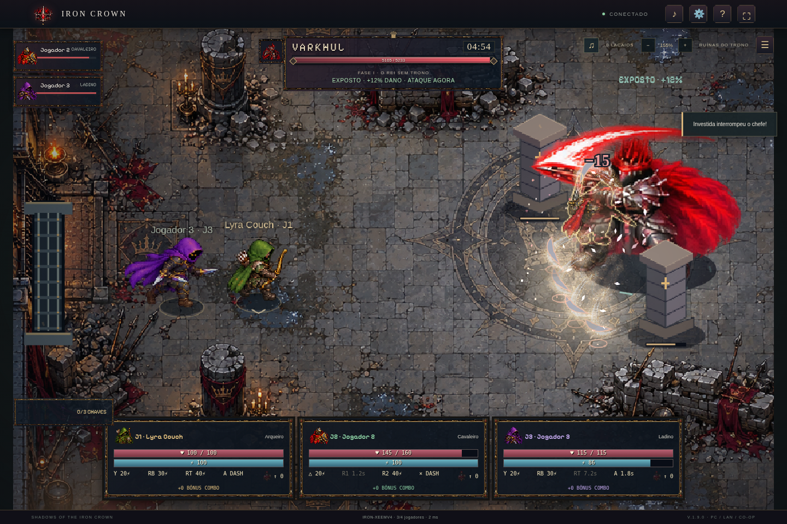

# Shadows of the Iron Crown

Jogo 2D cooperativo para PC Windows, com até 3 controles no mesmo PC ou até 4 jogadores na rede local, com servidor local incluído, três classes e três arenas. Jogue solo com companheiros ou com amigos na mesma rede, sem hospedagem paga. Há também um cliente web opcional para desenvolvimento.

## Baixar o jogo pelo GitHub

**[Baixar a versão Windows portátil](https://github.com/joaoviesilva0811-star/ExpotinGAME/releases/download/v1.7.0/IronCrown-Windows-x64.zip)** · **[Página da release](https://github.com/joaoviesilva0811-star/ExpotinGAME/releases/tag/v1.7.0)**

Extraia o ZIP completo e abra **Shadows of the Iron Crown.exe**. Não precisa instalar Node.js. A release é publicada pela automação do GitHub após a tag; o andamento aparece na aba **Actions**.

**Alternativa caso a release ainda esteja sendo preparada:** clique **Code → Download ZIP**, extraia o repositório inteiro e dê dois cliques em **JOGAR-WINDOWS.cmd**. Ele reúne as partes de `windows-package/`, confere o SHA-256, extrai o jogo e abre o executável. Mantenha os arquivos juntos. Nas próximas vezes, basta abrir o mesmo inicializador. A primeira extração pode levar alguns minutos.

O pacote pronto excede o limite de 100 MB por arquivo do GitHub. Por isso, o repositório guarda partes de até 32 MiB; o ZIP íntegro é anexado à release. Desenvolvedores também podem reconstruí-lo com `python3 scripts/restore-windows.py`.

[Prévia atual do aplicativo com controle](preview/previa-pc.mp4) · [Passagem pela masmorra](preview/corredor-2.png) · [Cutscene final](preview/pc-10-final.png)



## Jogar no PC sem pagar hospedagem

A edição PC portátil está em `dist/IronCrown-Windows-x64.zip`, para **Windows 10/11 de 64 bits**. Extraia tudo e abra **Shadows of the Iron Crown.exe**. Não é necessário instalar Node.js, ter uma hospedagem ou manter acesso à Internet.

- **Coop no mesmo PC:** até três controles Xbox/PlayStation, jogadores com sessões próprias, câmera compartilhada e HUD individual. Pressione um botão em cada controle na preparação; use ←/→ para classe, A/× para pronto e START/OPTIONS do líder para começar. As classes ausentes podem ser preenchidas por IA.
- **Solo com companheiros:** escolha uma classe; os dois bots usam as classes restantes. Se você é cavaleiro, recebe arqueiro e ladino. Os bots são identificados como IA, lutam com recursos normais, tentam esquivar, usam poções e podem reviver aliados. Podem cair, morrer e perder a rodada.
- **Hospedar na rede local:** um PC inicia o servidor automaticamente. Ele mostra IPv4 e código da sala. Precisa permanecer aberto durante a partida.
- **Entrar no PC de um amigo:** abra o executável no outro PC, informe o IPv4 do anfitrião e o código. Sem código, a lista mostra salas públicas daquele PC. Até quatro personagens; bots opcionais no lobby LAN.

Leia [o guia de PC/LAN](docs/PC-LEIA-ME.txt). A conexão local usa TCP 48230 na rede privada; não é preciso abrir portas do roteador. O solo só escuta em loopback. Contas e resultados são locais ao anfitrião; a versão LAN usa sessão rápida e HTTP na rede de confiança.

O pacote usa Electron 44.9.0 e Node 24.19.0 incluídos, com downloads oficiais verificados por SHA-256. A execução da aplicação empacotada foi validada no Linux; a execução do `.exe` em um Windows físico ainda precisa ser confirmada. Não há assinatura digital própria nem instalador. O código de empacotamento está em `scripts/desktop-build.js`.

Para desenvolvedores reconstruírem o pacote (Node 24+, npm e Python 3):

```sh
ELECTRON_SKIP_BINARY_DOWNLOAD=1 npm ci
npm run build:windows
```

O script baixa e verifica os runtimes antes de montar o ZIP. `npm run build:linux` cria a versão Linux equivalente para testes. `node scripts/desktop-smoke.js` testa o aplicativo Linux já empacotado, o runtime incluso, bots, troca de classe, duas instâncias conectadas por TCP, mesmo chefe e reconexão. As capturas são salvas em `artifacts/pc-*.png`. `node scripts/record-preview.js` grava a prévia por screencast do aplicativo em `artifacts/previa-pc.mp4`, com FFmpeg disponível.

## Jogar localmente

Requisito: **Node.js 24 ou superior**, com npm. Não é necessário PostgreSQL, Redis ou compilador. Para o modo de desenvolvimento via navegador, o cliente usa Canvas 2D e módulos JavaScript nativos, sem CDN. O servidor usa WebSocket (`ws`) e SQLite nativo do Node.

```sh
npm ci
npm start
```

Abra `http://localhost:3000`. Crie uma sessão com nome, crie uma sala e compartilhe o código. Cada pessoa escolhe uma classe e marca **Estou pronto**. O líder inicia a expedição. Para testar duas pessoas no mesmo computador, use uma janela anônima ou outro perfil do navegador: duas abas do mesmo perfil usam a mesma sessão e substituem a conexão anterior.

Para jogar pela rede local, acesse `http://IP-DO-SERVIDOR:3000` em cada dispositivo e permita a porta 3000 no firewall. HTTP é permitido apenas no desenvolvimento; use HTTPS/WSS na publicação.

## Controles

| Controle | Ação |
| --- | --- |
| WASD ou setas | Movimentação |
| Mouse | Mirar |
| Botão esquerdo segurado ou J | Ataque básico |
| 1, 2, 3 | Habilidades da classe |
| Espaço segurado | Defesa: −60% de dano, 15 energia/s |
| R segurado | Reviver aliado próximo por 4s, parado e sem sofrer dano |
| E | Dash: 20 de energia, 2,4s de recarga |
| 4 | Usar a próxima poção coletada |
| Tab | Emotes: passinho, braços cruzados, giro, celebração |
| Roda do mouse ou + / − | Aproximar/afastar câmera (inicia em 155%) |
| Esc | Menu local; **não pausa a partida online** |

No celular: joystick, ataque, escudo, reviver e habilidades na tela; mira automática no chefe e câmera que acompanha o jogador no modo retrato. Celular é um suporte inicial; PC oferece mais área visível.

[Prévia em vídeo](preview/previa-pc.mp4) · [A Câmara da Coroa](preview/15-native-vault.png) · [Animações novas](preview/15-walk-contact.png)

## Controles Xbox / PlayStation

| Controle | Ação |
| --- | --- |
| Analógico esquerdo / direito | Movimento gradual / mira |
| X / □ segurado | Ataque básico |
| A / × | Dash, 20 de energia |
| Y / △ | Habilidade 1 |
| RB / R1 | Habilidade 2 |
| RT / R2 | Habilidade 3 |
| LB / L1 ou LT / L2 | Defender segurado |
| B / ○ segurado | Reviver aliado próximo |
| D-pad ↑ / ↓ | Poção / alternar emotes |
| START / OPTIONS | Abrir/fechar menu |

Quando um controle está ativo, teclado e mouse deixam de comandar o combate. Esc abre/fecha o menu, onde o mouse funciona. Desconectar todos os controles devolve o controle do J1 ao teclado. A configuração usa a disposição standard da Gamepad API do Chromium incluído no aplicativo; reconhecimento de modelos físicos específicos depende do Windows. A validação usou dispositivos virtuais dessa API.

[Coop com três jogadores](preview/16-couch-battle.png) · [Preparação com controles](preview/16-couch-lobby.png)

## Atualização 1.7 — Nenhum Companheiro Fica Para Trás

Ataques básicos: **25 no cavaleiro, 32 no arqueiro e 18 no ladino**, com os mesmos intervalos, energia e habilidades. Chefes têm 15% mais vida para compensar parte do aumento e manter seus três estágios. O limite continua em cinco minutos por rodada.

**192 novas poses desenhadas** em três folhas: ajoelhar, estender a mão, canalizar ajuda, apoiar e levantar. São quatro vistas por ação, oito poses por vista; 3.016 quadros de atores no acervo. Mistura de poses acontece no renderizador e não conta como sprite novo. O movimento ou ataque pode interromper a apresentação de levantar, preservando a resposta dos controles.

Bots coordenam um resgatador por aliado, preservam a ajuda iniciada por humanos, contornam pilares e procuram um lugar seguro para os quatro segundos de canalização. Outros companheiros priorizam lacaios próximos ao resgate; o cavaleiro usa sua proteção quando disponível. Humanos e bots podem ajudar uns aos outros. Dano interrompe o canal, paredes impedem ajuda através de obstáculos e o aliado retorna com 40% da vida e uma breve proteção de 0,65s contra impactos da arena/projéteis.

**Poções e coroas redesenhadas:** 32 poses de objetos, frascos distintos de rubi e gelo, líquido/reflexos animados e coroas com metal e gemas. Arte integrada ao loot, inventário, menu e desfechos.

[Poções e coroas novas](preview/17-potions-crowns.png) · [Menu atual](preview/17-menu.png) · [Ver poses de auxílio e recuperação](preview/17-rescue-poses.png) · [Validação desta versão](docs/VALIDACAO.md)

## Atualização 1.6 — Aço em Movimento

1.464 novas poses desenhadas em 24 folhas de ataques, mais 376 poses de caminhada em seis folhas, somando 2.824 quadros de atores. Cavaleiro, arqueiro e ladino têm uma sequência para o básico e outra para cada habilidade; cada chefe tem três famílias de golpes e cada lacaio tem sua própria sequência. As oito direções acompanham a mira. As folhas têm seis a oito poses por direção; imagens interpoladas não entram na contagem de sprites.

O aplicativo mantém uma única janela ao navegar entre menu e partida. A música é parada ao sair de uma página e preservada ao abrir/fechar caixas de menu, sem trilhas sobrepostas. As quatro trilhas foram recompostas com motivos mais presentes e percussão reforçada; música e efeitos têm volumes separados na engrenagem.

Chefes continuam caminhando sob hits repetidos, com reação aditiva de corpo e brilho. Chaves maiores recebem apresentação de pelo menos 8,5 segundos, com destaque após a coleta. Combos contam acertos reais, expiram após 3,5 segundos e quebram ao sofrer dano; o multiplicador de pontos cresce a cada cinco hits, até ×1,75. O bônus é somado no resultado final.

O renderizador mistura poses alinhadas aos pés a cada quadro, mantendo preparação, liberação e recuperação ligadas ao tempo oficial do servidor. Armas e magia usam caches com margem. Caminhadas compartilham subposes em um cache limitado a 32 MiB, evitando redesenhar cópias iguais por lacaio a cada quadro. Partículas semelhantes são desenhadas em lote, fissuras são guardadas em caminhos reutilizáveis e os volumes usam texturas no tamanho necessário.

Na engrenagem, **Ajustar efeitos para priorizar 60 FPS** reduz gradualmente a densidade de fumaça, fragmentos e volumes quando o tempo de quadro sobe. O jogador, HUD e os contornos das áreas de perigo permanecem completos. A opção pode ser desligada. O alvo é 60 FPS; não há garantia para todo computador nem para os cenários extremos. Veja medições e limites em [Validação](docs/VALIDACAO.md).

[Novos ataques dos heróis](preview/16-strikes-heroes.png) · [Ataques dos chefes](preview/16-strikes-bosses.png) · [Lacaios](preview/16-strikes-minions.png)

## Atualização 1.5 — As Três Chaves

Cada chefe vencido deixa uma chave mágica personalizada. O grupo a recolhe automaticamente para destrancar a passagem seguinte. Conquiste as três para ver Aldric, Lyra e Nyx abrindo a Câmara da Coroa em um novo cenário com porta animada.

São 252 quadros adicionais de caminhada dos chefes e reação a dano, 984 quadros de atores no total. Movimento local com resposta imediata, interpolação remota, câmera com recuo direcional ao receber dano, iluminação dinâmica em 2D e bots com melhor separação e resgate. A engrenagem permite ajustar efeitos, tremor, luzes e ver FPS/P95/CPU. Os avisos de perigo continuam completos em todas as qualidades.

## Atualização 1.4 — Cerco das Feras

- Corrigidas as poses desenhadas do arqueiro: as vistas leste, nordeste e sudeste usam as vistas opostas verificadas, espelhadas. Capuz, corpo e arco acompanham a direção do disparo.
- Ondas de quatro lacaios para equipes de três/quatro integrantes, chegando a cinco na fase final. Equipes menores recebem dois. Limite simultâneo ajustado pelo grupo, até dez; primeira onda aos oito segundos, seguintes a cada 20/17/14s conforme a fase.
- Cada chefe tem oito padrões (24 no total), com seleção por distância: pressão de perto, projéteis, faixas e marcas para alcançar jogadores afastados. Varkhul usa estilhaços e execução circular; Tharazul lança sementes e prende com raízes; Azrakiel combina lanças do vazio e golpes da foice.
- Efeitos intensos com 54 quadros originais de erupção, rochas, fumaça, raízes e cristais, sobrepostos em volume. Até 1.800 partículas, 96 nuvens e 160 erupções desenhadas por quadro, com cache de texturas e aviso de perigo por cima dos efeitos.
- Impactos dos chefes cobrem o interior e a largura da área atingida: fissuras e fragmentos no castelo, raízes na floresta e estilhaços do vazio na catedral. Frentes de choque respeitam cones, faixas e o centro seguro dos anéis.
- Partículas, superfícies e dano usam a mesma geometria. Os efeitos de impacto são desenhados no chão, abaixo dos personagens, com limites de quantidade.

[Ver o arqueiro em disparos reais](preview/14-archer-real-directions.png) · [Ver os impactos por arena](preview/14-area-impacts.png)

## Atualização 1.3 — Ferro e Cinzas

- Menus, seleção de classe, HUD e diálogos com molduras ilustradas de ferro, madeira e bronze; botões com relevo e retratos de quem fala.
- Falas aparecem gradualmente, com identificação do personagem e da arena. Legendas do despertar ficam separadas da caixa de diálogo.
- Marcações rúnicas com borda fixa, preparação progressiva e interior discreto. O centro seguro dos anéis permanece limpo, sem traço ligando os dois contornos.
- Cortes com lâminas afiladas, rastros duplos do ladino, faíscas direcionais, fragmentos e poeira; flechas com haste, ponta e penas, e trilhas distintas de gelo.
- Arqueiro mantém a orientação entre disparos, ao mirar em movimento e ao receber dano. Oito direções reais; a liberação da corda acompanha o disparo. Corrigida a mira vertical e de habilidades enviadas antes do próximo passo do servidor.
- A mira é recalculada sob o mouse enquanto a câmera se move. Chapéus retirados da seleção, da renderização e do estado multiplayer. Emotes continuam disponíveis no Tab.

[Ver diálogos](preview/13-dialogue-boss.png) · [Ver oito direções e efeitos](preview/13-directions-effects.png)

## Atualização 1.2 — Combate e direção artística

- Caminhada 35–37% mais lenta, ataques básicos com antecipação e câmera próxima (155%), suave e ajustável até 200%.
- 3.016 quadros nos atlas dos personagens: caminhada, reação a dano, golpes, invocação e quatro emotes. Ataques de heróis, chefes e lacaios escolhem oito direções; onde necessário, uma direção usa espelhamento de uma pose compatível.
- Oito padrões por chefe, três fases, projéteis hostis, investidas, ondas com centro seguro, cruzes e ataques em sequência. Vida base para quatro jogadores: 5.600 / 7.200 / 9.200, ajustada ao grupo.
- Lacaios mortais com preparação visível, colisões, invocação limitada e drops. Primeiro abate sempre derruba poção; depois há chance de 46%. Três espaços de inventário; coleta por proximidade. Cura +45 ou gelo em raio de 230 com lentidão de 4s; tecla 4 usa a primeira guardada.
- Dash no E: custa 20, recarga de 2,4s e proteção de 0,24s. Reviver passa para R. Tab abre quatro danças próprias; interrompidas ao mover, atacar ou sofrer dano.
- Castelos, floresta e catedral com coberturas distintas que bloqueiam flechas e projéteis. Chefes contornam obstáculos e miram o grupo; a área anunciada fica fixa para permitir a esquiva.
- HUD com ícones desenhados, molduras de metal, zonas de perigo com contorno/progresso, poeira, faíscas, fragmentos, rachaduras, rastros de flecha e efeitos de gelo.
- História em três capítulos, cutscenes de entrada com portão, despertar próprio de cada chefe, corredor animado entre arenas e epílogo com três desfechos e câmara secreta de 18s na vitória completa. Cenas ficam fora dos 300s de combate.
- Cenários pintados detalhados com mosaicos, velas, reflexos e coberturas; colisões e recortes de oclusão seguem os objetos desenhados. Botões com bordas e fonte em pixel.
- Menu com ilustração original; tema próprio, três trilhas de combate e sons de armas e chefes, disponíveis offline. Som inicia após a primeira interação; botão musical permite silenciar. Os emotes não incluem músicas licenciadas do TikTok.

O tempo observado na versão 1.7 em uma simulação de quatro participantes usando comandos normais foi aproximadamente 57s / 63s / 80s. Não é duração garantida: habilidade, classe, tamanho da equipe e mortes alteram cada luta; o limite continua 5 minutos por chefe.

## Implementado

- Modo solo com dois companheiros das outras classes e LAN nativo sem hospedagem.
- Login rápido com sessão temporária, cadastro e login por senha, recuperação da sessão por token de 256 bits. Código de sala é separado da autenticação.
- Salas privadas/públicas para 4 jogadores, código aleatório, copiar código, líder, classes, prontos, saída e reconexão com vaga reservada por 60s.
- Simulação autoritativa a 20 Hz: posições, limites, obstáculos, alcance, mira, colisão de projéteis, dano, recursos e intervalos. Cliente envia intenções; não escolhe dano, vida ou posição oficial.
- Cavaleiro (160 HP), arqueiro (100 HP) e ladino (115 HP), com habilidades próprias, ataques básicos, defesa, 100 de energia, regeneração de 12/s, custos 20/30/40 e recargas de 2/6/12s.
- Varkhul, Tharazul e Azrakiel, perseguição, preparação, execução, recuperação e transição de fase. Golpes anunciados por áreas na arena; nuvens tóxicas, raízes sólidas, marcas, cones e ataques que quebram defesa.
- Três rodadas de até 300s, abertura sincronizada de 17,7s (chegada, portão, diálogo, despertar e contagem), intervalo de 11s com travessia de corredor, derrota por tempo/equipe caída, vida parcialmente recuperada, revives e retorno na rodada seguinte.
- HUD, barras e números, habilidades com recarga, aliados, alertas, resultados, estatísticas, pontuação, recorde da formação e ranking persistente.
- Atlas dos personagens feito nesta conversa, recortado em tempo de renderização, com direções e poses de ataque; sprites de segurança desenhados em código enquanto o atlas carrega.
- Arenas em pixel art, luzes, partículas, impacto, rastros, escudos, sons e trilha sintetizada distinta por arena. O áudio inicia após interação e pode ser silenciado no botão de nota musical, respeitando o bloqueio de autoplay dos navegadores.
- Validação de entradas, limites de mensagens, origem autorizada, expiração de sessão, senhas com `scrypt` e tokens armazenados como hash no banco.

## Publicação na InfinityFree

Leia [docs/PUBLICAR.md](docs/PUBLICAR.md). O pacote `dist/infinityfree-cliente.zip` contém só os arquivos estáticos para enviar a `htdocs`. O pacote completo inclui cliente, servidor, testes e instruções.

```sh
npm run build
```

**Não envie somente o cliente sem ligar/configurar o backend:** não há salas locais falsas nem substituição do servidor por combate no navegador.

## Configuração e persistência

Copie `.env.example` para `.env` se precisar mudar porta, origem permitida ou diretório do banco. O servidor lê `.env` automaticamente. Não coloque credenciais em `public/config.js`.

- `HOST`: padrão `0.0.0.0`.
- `PORT`: padrão `3000`.
- `DATA_DIR`: diretório gravável e persistente; padrão `./data`.
- `ALLOWED_ORIGINS`: origens exatas separadas por vírgula, como `https://seujogo.example`. A própria origem do backend também é aceita.
- `NODE_ENV=production`: rejeita autenticação por HTTP.
- `TRUST_PROXY=1`: aceita indicação de HTTPS do proxy; use somente atrás de um proxy confiável que substitui o cabeçalho `X-Forwarded-Proto`.

`data/iron-crown.sqlite` guarda contas, hashes de sessão e resultados. As tabelas e os índices são criados automaticamente por migração versionada no `server/store.js`. Não apague o volume ao atualizar o servidor. Faça backup consistente com a API de backup do SQLite ou pare o servidor antes de copiar o banco e seus arquivos WAL. Nunca publique o diretório `data`.

As **salas em andamento ficam em memória**: queda ou reinício do servidor encerra essas partidas. Reconexão preserva a partida quando apenas o cliente perde conexão. Conta persiste até remoção do banco; sessões de convidados duram 24h e de contas, 7 dias. Não há recuperação de senha por e-mail nesta versão.

## Testes

```sh
npm test
```

Os testes cobrem regras de combate, custos, anti-spam, defesa, alcance, projéteis, classes, fases, revives, limites, liderança, salas, progressão das três rodadas, vitórias/derrotas, cadastro, login, origens e duas conexões WebSocket independentes com dano compartilhado e reconexão.

Com o servidor em execução e Chromium instalado, execute o teste visual:

```sh
node scripts/browser-smoke.js
```

Ele usa dois contextos independentes do navegador, testa o fluxo real de sala, movimentação, habilidades, defesa, sessão restaurada e controles móveis, e salva capturas em `artifacts`. Defina `CHROMIUM_PATH` se o executável não estiver em `/usr/bin/chromium`. Este teste não é necessário no servidor de produção.

Para a aceitação das três rodadas, `node scripts/full-match.js` abre quatro sessões independentes, usa controles automatizados apenas no teste e verifica vitória e pontuação iguais em todos os clientes. Nenhuma vida, recarga ou resultado é forçado no servidor. Veja [docs/VALIDACAO.md](docs/VALIDACAO.md) para os resultados desta entrega.

## Organização

```text
desktop/       Aplicativo de PC, menu nativo, IPC seguro e bootstrap do servidor
public/        Cliente, renderização, arte, áudio, interface e configuração pública
server/        HTTP, WebSocket, autenticação, SQLite e simulação autoritativa
test/          Testes unitários e integração com clientes WebSocket independentes
scripts/       Empacotamento e teste de navegador
docs/          Guia de publicação e arquitetura
dist/          Pacotes gerados por npm run build
```

## Limites desta entrega

Esta versão tem balanceamento inicial reforçado por simulações de equipe, mas ainda não houve teste de carga em larga escala nem avaliação com jogadores externos. A base até a versão 1.5 tem 984 quadros desenhados: 108 novas poses de caminhada dos chefes e 144 reações direcionais de dano, somadas à base de 732: 216 de movimentos/reações, 288 de ataques direcionais dos heróis/chefes, 72 de emotes e 156 de lacaios. O acólito reutiliza uma direção espelhada para completar os oito sentidos. A versão 1.6 acrescenta 1.464 poses de ataque e 376 de caminhada, totalizando 2.824; a versão 1.7 acrescenta 192 poses de auxílio e recuperação, chegando a 3.016. Não há animação por esqueleto: o Canvas mistura poses completas alinhadas e acrescenta transformações de impacto. Trilha e efeitos são composição e síntese próprias renderizadas em Ogg, sem gravações orquestrais ou músicas do TikTok.

O servidor opera como uma instância única. Não há coordenação multi-instância, chat, matchmaking automático, cadastro por e-mail ou restauração de partidas após reinício. O ranking agrupa a formação por seus nomes de exibição ordenados; não é um sistema competitivo com identidade verificada. HTTPS, domínio, disco persistente e publicação dependem da hospedagem escolhida e não são fornecidos pelo código. Para a edição PC/LAN, a hospedagem não é necessária. O Dockerfile é uma opção de empacotamento e exige validação na hospedagem de destino.

Nove modelos de impacto distinguem brasas, corte de aço, onda de pedras, raízes, nuvem venenosa, correntes, cristais, corte de foice e fenda do vazio. A seleção usa o tipo de área publicado pelo servidor; cortes acompanham o ângulo do golpe e nuvens de veneno não usam raízes.

[Prévia dos nove modelos de impacto](preview/141-effect-models.png) · [Arqueiro em oito direções](preview/14-archer-real-directions.png)

## Correção 1.4.1 — efeitos completos

Cada efeito usa sua própria folha com seis quadros e margens transparentes. O cache preserva a célula inteira e registra as poses pelo mesmo ponto de contato com o chão. Cortes, fumaça, raízes e explosões não são mais amputados pelo recorte dos anéis; a geometria de dano e a borda do centro seguro continuam no chão.

[Revisão dos 54 quadros](preview/141-all-effect-frames.png)
